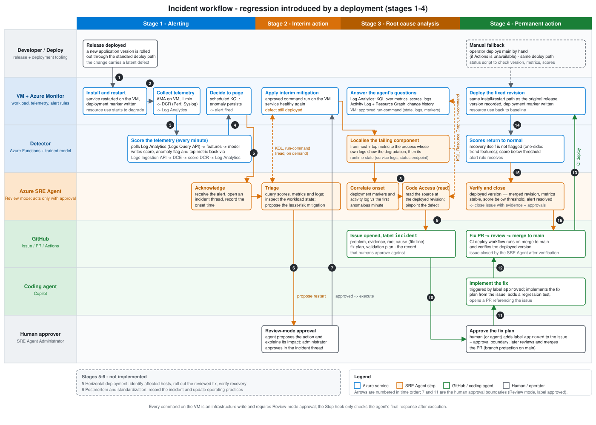

## VM anomaly detection with Azure SRE Agent

This repository demonstrates an end-to-end reliability workflow for virtual
machines on Azure. A machine-learning detector identifies abnormal memory, CPU,
or disk behavior from Azure Monitor telemetry. Azure SRE Agent investigates the
alert, proposes a human-approved mitigation, traces the anomaly to the code path
and the change that triggered it, and coordinates a permanent code fix through
GitHub.

The included incident scenario triggers a latent memory leak in a small web
service with a burst of historical-report requests; nothing is redeployed.
The same detection and triage path supports CPU saturation and disk-fill
anomalies without changing the workflow.

## Operations lifecycle

The workflow detects the anomaly, mitigates its impact, identifies the defect,
and deploys a reviewed fix. The last two lifecycle stages describe fleet rollout
and postmortems; neither is automated in this repository.

| Stage | Operation |
|-------|-----------|
| 1. Alerting | Detect anomalous VM behavior and raise an Azure Monitor alert |
| 2. Interim action | Triage the affected resource and apply a human-approved mitigation |
| 3. Root cause analysis | Correlate telemetry, deployments, logs, and source code |
| 4. Permanent action | Approve, deploy, and verify the code fix |
| 5. Horizontal deployment | Identify other affected VMs and roll out the reviewed fix. **Not implemented.** |
| 6. Postmortem and standardization | Record the incident and update operational practices. **Not implemented** as automation; a manual template is provided. |

## What the demonstration covers

The scripted demonstration starts a batch client on the VM that requests
historical reports. The service keeps every historical report in an unbounded
archive, which gradually consumes VM memory. An Azure Function scores one-minute telemetry windows with
resource-specific Isolation Forest models and writes the results to
`VMAnomalyScore_CL`. Azure Monitor raises an alert after the anomalous score is
sustained.

Azure SRE Agent identifies the affected host, resource, and process, then
proposes a service restart in Review mode. After human approval, the agent
correlates the anomaly with deployment and traffic markers and source code and
opens a GitHub incident with the findings. A second human approval dispatches
Copilot to prepare the permanent fix, and a human merges it. After deployment,
Azure SRE Agent verifies the deployed revision, recovered telemetry, normal
anomaly scores, and resolved alert, and reports the evidence on the issue; a
human closes it. The agent never merges pull requests or closes issues.

## System architecture

## System highlights

| Area | Implementation |
|------|----------------|
| Telemetry | Azure Monitor Agent, Data Collection Rules, Log Analytics `Perf`, `Syslog`, and `AzureActivity` |
| Detection | Azure Functions timer trigger, Isolation Forest models, custom `VMAnomalyScore_CL` table |
| Model lifecycle | Azure Machine Learning training, evaluation, registration, and model export |
| Incident response | Azure SRE Agent response plan, triage skill, managed identity, and Review-mode approval |
| Delivery | GitHub Issues, Copilot coding agent, GitHub Actions, and OIDC-based Azure deployment |
| Infrastructure | Subscription-scoped Bicep for the VM, monitoring, detector, identities, roles, alerts, and SRE Agent |

## Repository map

| Directory | Purpose |
|-----------|---------|
| `app/` | Demo web service and systemd deployment assets |
| `dashboard/` | Single-view animated status dashboard with click-through links |
| `detector/` | Azure Function that scores live VM metrics |
| `infra/` | Bicep modules and deployment scripts |
| `ml/` | Model training, evaluation, Azure ML jobs, and export tooling |
| `sre-agent/` | Response plan, triage skill, approval hook, and demo prompts |
| `scripts/` | Incident injection, mitigation, status, setup, and deployment helpers |
| `tests/` | Offline tests for the application, detector, ML pipeline, and workflows |
| `docs/` | Technology overview, architecture, runbook, and modeling details |

## Run the demonstration

1. Complete the [environment setup](docs/10-environment-setup.md).
2. Deploy the Azure resources described in the
   [architecture](docs/03-architecture.md).
3. Configure the [SRE Agent connections and permissions](sre-agent/README.md).
4. Configure [GitHub Actions and repository labels](docs/08-github-actions-setup.md).
5. Follow the [demo runbook](docs/04-demo-runbook.md) to inject the incident,
   approve mitigation, review the fix, and verify recovery.
6. Optionally, follow the whole incident on one screen with the
   [status dashboard](dashboard/README.md).

For an offline preview, run `uv run python -m dashboard.server --demo`.
This needs no Azure resources or credentials.

## Documentation

| Document | Description |
|----------|-------------|
| [Technology overview](docs/02-technology-overview.md) | Service roles, detection approach, and data sources |
| [Architecture](docs/03-architecture.md) | Deployed components, resource defaults, and interfaces |
| [Demo runbook](docs/04-demo-runbook.md) | End-to-end operational procedure |
| [Workflow and architecture](docs/05-workflow-and-architecture.md) | Detailed components, data flows, and incident sequence |
| [Modeling alternatives](docs/06-modeling-alternatives.md) | Model-family comparison and selection rationale |
| [Modeling and evaluation](docs/07-modeling-and-evaluation.md) | Training pipeline, datasets, metrics, and reproduction |
| [GitHub Actions setup](docs/08-github-actions-setup.md) | OIDC, secrets, Copilot dispatch, and labels |
| [Status dashboard reference](docs/09-status-dashboard.md) | Data sources, status derivation, and controls |
| [Environment setup](docs/10-environment-setup.md) | Prerequisites, local settings, sign-in, and deployment |

## License

Microsoft-authored code is licensed under MIT. Bundled libraries and product
artwork retain their own terms; see [third-party notices](THIRD-PARTY-NOTICES.md).

## Cost and cleanup

This is a demonstration environment, not a production reference deployment. It
uses a single Linux VM, Log Analytics, Azure Functions, Azure Machine Learning,
and an always-on Azure SRE Agent. Review the resource sizes and tear down the
environment after use to avoid ongoing charges.

Azure SRE Agent has always-on and active-flow charges, including background
work. Stopping the agent does not remove every charge, and recreating it can
affect trial eligibility. Check current pricing and usage; see
[SRE Agent cost and free trial](sre-agent/README.md#cost-and-free-trial) before
you tear down or redeploy.
