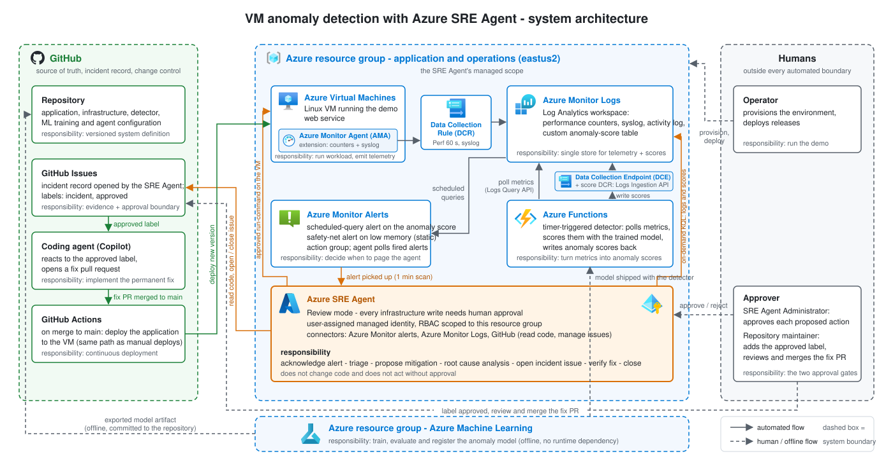
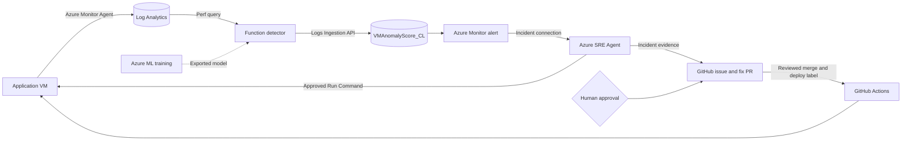

## Architecture

The sample separates live incident operations from model training. The
application, telemetry, detector, and SRE Agent share a demonstration resource
group. Azure ML runs in a separate resource group and exports a model artifact
that the detector loads locally.





### Incident stages

| Stage | Component | Evidence in demo |
|-------|-----------|------------------|
| 1 Alerting | `detector/` scores `Perf` each minute and writes `VMAnomalyScore_CL`; Azure Monitor evaluates the score and low-memory rules | Scores, affected resource group, first anomalous timestamp, and fired alert |
| 2 Interim action | SRE Agent queries `VMAnomalyScore_CL` (`Details.groups`, `Details.contributions`) and the matching `Perf` counters, names the failing process from `Syslog`, proposes `systemctl restart demo-app.service` via `az vm run-command` (Review approval) | Affected counter returns to baseline, latency recovers, incident thread records approval |
| 3 RCA | Correlate `Perf`, `Syslog`, `AzureActivity`, `DEPLOY_LOG` and `/version`; Code Access reads deployed `app/server.py` and identifies the unbounded historical-report archive; GitHub connector opens a labeled incident issue | Issue includes timestamps, deployed commit/file:line, fix and validation evidence |
| 4 Permanent action | Human labels issue `approved` → `incident-approved.yml` assigns Copilot; fix PR labelled `deploy` and merged to `main` by a human triggers `deploy-app.yml` → agent verifies SHA, affected counter back at baseline, Score < 0.8 for 10 min and resolved alert, then comments the evidence; a human closes the issue | Code fix deployed (demo: archive bounded); evidence in issue and PR |

---

## Repository layout

```text
docs/                     architecture, operating guides, model evaluation
infra/                    Bicep (subscription scope) + deploy/teardown scripts
  main.bicep              RG, network, VM, monitoring, function, sre-agent modules
  modules/                network, VM, monitoring, Function, roles, SRE Agent, Azure ML
  deploy.sh  teardown.sh  main.bicepparam
app/                      demo web service with an intentional historical-report leak, systemd unit
scripts/                  incident trigger/reset, mitigation, deployment, status
.github/                  deploy-app.yml, incident-approved.yml, incident template, labels, setup guide
ml/                       training package (runs locally and as Azure ML command job)
  data/                   synthetic series and benchmark dataset downloaders
  features.py             windowing + feature engineering shared with detector/
  models/{sr.py,iforest.py,autoencoder.py}
  train.py  evaluate.py   CLI: python -m ml.train --dataset smd --model iforest --out outputs/
  azureml/{job.yaml,env.yaml,submit.py,register.py,export.py}
detector/                 Azure Functions (Python v2 model), timer 1 min
  function_app.py         query LAW → features → score → Logs Ingestion API
  scorer.py               loads model/, same features as ml/features.py
  model/                  exported model artefacts (committed small .pkl + metadata.json)
  local.settings.json.example  requirements.txt  host.json
sre-agent/                configure.py and portal-based agent configuration
  response-plan.md        incident response instructions
  skills/vm-anomaly-triage/SKILL.md
  hooks/vm-remediation-approval.yaml
  prompts.md              chat prompts used in the demo
tests/                    pytest for app/, ml/, detector/ and workflow triggers (offline, no Azure)
```

## Resource defaults and interfaces

Set tenant, subscription, and repository values through the environment setup.
The table lists the defaults for a fresh deployment.

| Item | Value |
|------|-------|
| Location | `eastus2` |
| Demo RG | `rg-vm-anomaly-demo` |
| ML RG / workspace | `rg-vm-anomaly-ml` / `mlw-vm-anomaly` |
| VM | `vm-app-01`, `Standard_D2s_v7` (overridable), Ubuntu 22.04 Gen2, admin `azureuser` (SSH key, no password) |
| App | `demo-app.service`, listens `:8080`, endpoints `/`, `/health`, `/version`, `/report`, `/reports`, `/stats`; `/opt/demo-app/DEPLOY_LOG` appended on every deploy (`<ISO time> deploy <ref> by <who>`) |
| LAW | `law-vm-anomaly-demo`; tables `Perf`, `Syslog`, `AzureActivity`, custom `VMAnomalyScore_CL` |
| DCR (guest perf) | `dcr-vm-perf`: Perf counters `\Memory\% Used Memory`, `\Memory\Available MBytes Memory`, `\Memory\% Used Swap Space`, `\Processor(*)\% Processor Time`, `\Logical Disk(*)\% Used Space`, `\Network(*)\Total Bytes`, sample 60 s; Syslog facilities `daemon`, `syslog`, `user` (info+) |
| DCE / DCR (scores) | `dce-vm-anomaly`, `dcr-vm-anomaly-scores`, stream `Custom-VMAnomalyScore_CL` → table `VMAnomalyScore_CL` |
| `VMAnomalyScore_CL` schema | `TimeGenerated: datetime`, `Computer: string`, `Score: real` (0–1, higher = more anomalous), `IsAnomaly: bool`, `Model: string`, `TopFeature: string`, `Details: string` (JSON) |
| Function | `func-vm-anomaly-<uniqueString>`, Python 3.11, Flex Consumption, system-assigned identity with **Log Analytics Reader** on LAW and **Monitoring Metrics Publisher** on the DCR. App settings: `LAW_WORKSPACE_ID` (customer id), `DCE_ENDPOINT`, `DCR_IMMUTABLE_ID`, `DCR_STREAM=Custom-VMAnomalyScore_CL`, `TARGET_COMPUTER=vm-app-01`, `SCORE_THRESHOLD=0.8` |
| Alerts | `alert-ml-anomaly-vm-app-01` (scheduled query, `VMAnomalyScore_CL | where IsAnomaly | summarize count() by bin(TimeGenerated,1m)` ≥ 3 of last 5 min, sev 2), `alert-mem-low-vm-app-01` (memory-only safety net: scheduled query over `Perf` Available MBytes Memory < 200 MB 5 min, sev 3); both attached to action group `ag-vm-anomaly` |
| SRE Agent | `sreagent-vm-anomaly`, identity `id-sreagent-vm-anomaly`, `actionConfiguration.mode=Review`, `accessLevel=High`, `managedResources=[demo RG]` |
| Model artefact | `detector/model/model.pkl` (sklearn/joblib) + `detector/model/metadata.json` `{model, features:[...], groups:{memory|cpu|disk: {features, calibration}}, calibration, feature_stats, window:int, threshold:float, trained_on, metrics:{...}}`; `model.pkl` is `{group: sklearn Pipeline}`, `Score = max_g calibrate_g(-pipe_g.score_samples(X[f_g]))` |
| Feature contract | `ml/features.py::make_features(df: DataFrame[timestamp, <metric cols>], window=30) -> DataFrame` — rolling mean/std/slope/min/max per metric plus first differences; identical code imported by `detector/scorer.py` (detector vendors a copy `detector/features.py` kept in sync by `tests/test_feature_parity.py`) |
| Live metric columns | `mem_used_pct, mem_available_mb, swap_used_pct, cpu_pct, disk_used_pct, net_bytes` (from the DCR counters above; detector pivots `Perf` into these) |

## Deployment

Bicep creates the Azure resources. `detector/deploy.sh` publishes the Function
code and model, and `sre-agent/configure.py` applies the agent's response plan,
skill, and connections. GitHub OAuth requires interactive authorization.

The VM denies inbound traffic through its network security group. Guest
inspection and app deployment use Azure VM Run Command. Every Run Command
invocation by SRE Agent requires Review-mode approval.
