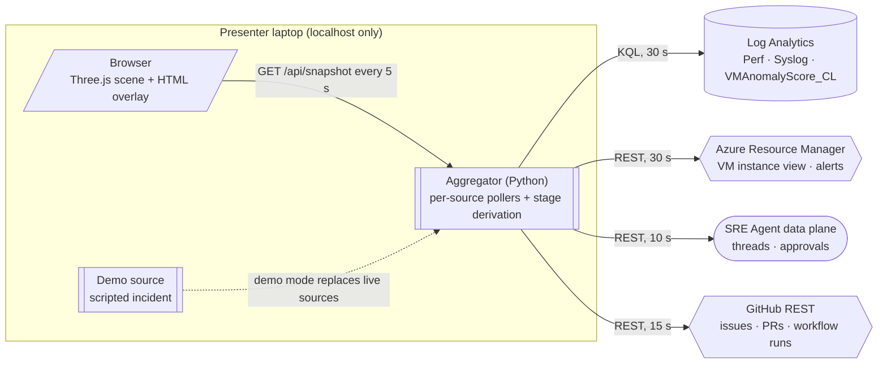
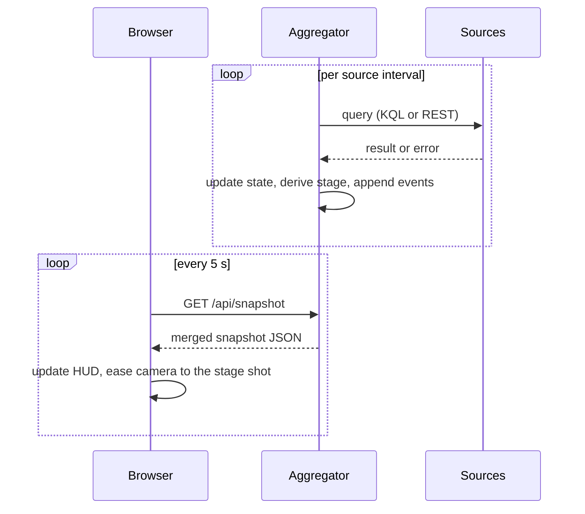
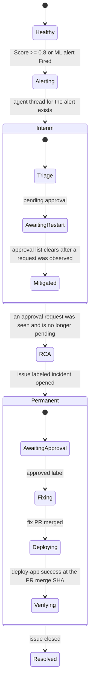

## Status dashboard reference

The local dashboard displays VM telemetry, detector scores, alerts, SRE Agent
activity, and GitHub incident status. It tracks stages 1-4 and shows stages 5-6
as **not implemented** lifecycle references.

Approvals stay in the SRE Agent portal and GitHub [11]. Links open the source
evidence or approval page; the dashboard itself does not approve actions.

---

### What the view shows

Each status item maps to a source that already exists in the deployment. The
refresh intervals follow the rate at which each source changes: telemetry and scores
arrive once per minute, while agent approvals and GitHub events are discrete and
should appear quickly.

| Domain | Status shown | Source | Access | Refresh |
|--------|--------------|--------|--------|---------|
| VM | Power state | Azure Resource Manager VM instance view | REST, Reader | 30 s |
| Guest metrics | Memory, swap, CPU, disk | Log Analytics `Perf` | KQL | 30 s |
| Demo service | `rss_mb`, `cache_entries`, `version` | Log Analytics `Syslog` health line written by `app/server.py` once per minute | KQL | 30 s |
| Deployments | Deployed ref and time | `Syslog` marker `demo-app deploy <ref>` | KQL | 30 s |
| Detector | `Score`, `Details.groups`, `TopFeature`, age of the latest bin | `VMAnomalyScore_CL` | KQL | 30 s |
| Alerts | Monitor condition, state, severity of both alert rules | Alerts Management REST API [3] | REST, Monitoring Reader | 30 s |
| SRE Agent | Threads, latest steps, pending approvals | SRE Agent data plane `/api/v1/threads`, `/api/v1/approvals/{threadId}` [1] | REST, `https://azuresre.dev` token | 10 s |
| Ticket | Incident issue, labels, linked fix PR, merge state | GitHub REST issues and pulls [4] | REST, token | 15 s |
| Delivery | `incident-approved.yml` and `deploy-app.yml` runs, deployed SHA | GitHub REST workflow runs [5] | REST, token | 15 s |

The demo service endpoints (`/health`, `/version`, `/stats`) are deliberately not
polled. The network security group denies all inbound traffic to `vm-app-01`, and the
only path to them is `az vm run-command`, which takes tens of seconds, counts as an
infrastructure write, and appears in `AzureActivity`. The `Syslog` health line
already carries RSS, cache size and version, so it replaces those endpoints.

---

### Access and freshness

The backend needs Log Analytics query access, Reader/Monitoring Reader access
to the demo resources, SRE Agent data-plane access, and a GitHub token able
to read the repository. Check the effective roles for the target environment;
permission to read an agent does not establish permission to approve actions.

Telemetry collection, ingestion, detector settling, and source polling all add
delay [2]. Use the per-source age and error indicators rather than assuming a
fixed end-to-end latency. GitHub rate limits also apply [6].

If polling fails, the aggregator retains the last successful values and exposes
the source error. Cached state is not evidence that the source is currently healthy.

---

### Architecture

The aggregator runs on the presenter's laptop and signs in with the existing Azure CLI
session through `DefaultAzureCredential` and with a GitHub token from the
environment. It binds to `localhost`. Credentials are used by the backend for
the intended Azure and GitHub requests and are not sent to the browser.
Each source is polled on its own interval and cached; the browser reads a single
merged snapshot.

Polling is chosen over WebSocket or server-sent events because the data changes at
minute granularity for telemetry and at human speed for approvals. A 5 s poll of a
local endpoint is stateless and simple, and the added delay is small compared with
the source latency.

In **demo mode** a scripted source replaces the live pollers and plays the memory-leak
incident from the demo runbook [12], time-compressed and looping. The
scripted state passes through the same stage derivation, event log and link builder as
live data, so it supports rehearsal and is the fallback when the venue network fails.
Demo mode plays synthetic state, not a recording of an Azure incident.

#### Snapshot contract

| Field | Content | Source |
|-------|---------|--------|
| `generated_at`, `mode`, `refresh_ms` | Snapshot time (UTC), `live` or `demo`, browser poll interval | Aggregator |
| `stage` | `current`, `waiting_for` (none, human, system), `detail`, `evidence` | Stage derivation |
| `state.power_state`, `state.metrics` | Power state; memory, CPU, disk | Resource Manager, `Perf` |
| `state.service` | `rss_mb`, `cache_entries`, `version`, last deployed ref and time | `Syslog` |
| `state.detector` | `score`, `groups`, `top_feature`, 60-minute `series`, `latest_bin` | `VMAnomalyScore_CL` |
| `state.alerts[]` | Rule, monitor condition, severity, fired time | Alerts Management |
| `state.agent` | Thread ID, title, steps, pending approvals | SRE Agent data plane |
| `state.ticket` | Issue number, state, labels; PR number, merged SHA; latest workflow runs | GitHub |
| `events[]` | Time, source, message, `link_id` | Derived from changes between polls |
| `sources[]` | Per source: `ok`, `age_sec`, last error | Aggregator |
| `links` | Item ID to `{url, label, exact}`, where `exact` is false for fallback links | Link builder in the aggregator |

The presenter pin is applied in the browser and never changes the snapshot.

The scene and HUD render the merged snapshot rather than querying cloud services.

---

### Stage derivation

The current stage is derived from observable evidence rather than stored separately.
Each transition appends the evidence that caused it to the event log, so the audience
can see why the view advanced.

The stage display is a heuristic, not recovery verification. Closing an issue marks
it resolved in the view; the operator must still check the telemetry, deployed
revision, and alert state. Stages advance monotonically within an incident.

Heuristics can misfire, for example when the agent skips a proposed restart. The
move from stage 2 to stage 3 relies on having seen the approval request, so a dashboard
started after the restart was approved stays on stage 2 until the incident issue opens.
The presenter can pin a stage with keys `1` to `4`; the HUD shows the pin so that the
override is visible.

---

### Scenario controls

A bar under the status banner offers **Inject memory leak**
(`scripts/inject_traffic.sh`, one bulk history export, no deploy) and **Stop
incident** (`scripts/stop_traffic.sh`). The buttons act immediately,
without a confirmation dialog, and the bar shows the progress and result of the
last action. In demo mode the same buttons move the scripted scenario to the
traffic start or back to the start.

The command path is separate from the snapshot query. `POST
/api/actions/{name}` runs only names from a fixed allow-list, never user input,
one action at a time, with no shell. The server accepts the request only from
its own page: the `Origin` must match the dashboard and the custom
`X-Dashboard-Action` header must be present, which other sites cannot send
without a CORS preflight that the server never answers. **Inject** is disabled
while `vm-app-01` is not running.

### Click-through navigation

Clicking a 3D node, a HUD row, a timeline stage or an event opens the page that
holds the full detail. The aggregator builds every URL, because it already knows the
tenant, the resource IDs, the SRE Agent thread ID and the GitHub `html_url` values.
The browser only renders `links[itemId]`, and items without a link, such as an issue
that does not exist yet, are not clickable.

| Item | Destination | URL source |
|------|-------------|------------|
| `vm-app-01` node, VM panel | VM overview in the Azure portal | Resource ID |
| Guest metrics, service RSS, deployed version | Log Analytics with the matching `Perf` or `Syslog` query and time range | Workspace ID and query [9] |
| Log Analytics node | Workspace Logs blade | Resource ID |
| Detector node, score panel | Log Analytics with the `VMAnomalyScore_CL` query from `scripts/status.sh` | Workspace ID and query [9] |
| Detector node, secondary | Function App overview | Resource ID |
| Alert node, alert rows | Alert rule page, which lists its fired and resolved instances | Rule resource ID |
| SRE Agent node, thread steps | Incident thread in the SRE Agent portal | Thread ID [8] |
| Gate 1, approval card | Same thread, where the restart is approved | Thread ID |
| Gate 2, incident issue row | GitHub issue, where the `approved` label is added | `html_url` |
| Fix PR row | GitHub pull request | `html_url` |
| Workflow run rows | GitHub Actions run | `html_url` |
| Timeline stage | Main evidence of that stage: alert, thread, issue, or deploy run | Derived from the stage evidence |
| Event log row | Source of that event | Captured with the event |

Links open in a new tab, so the dashboard keeps its state and remains the tab the
presenter returns to. Each destination system uses a fixed window name
(`azure-portal`, `sre-agent`, `github`) [10], so repeated clicks reuse one
tab per system instead of piling up tabs during the demonstration.

Drag the scene to orbit without opening a link. The tooltip names each destination;
fallback links add "(overview)". Panel links are reachable with Tab and Enter.

Demo-mode links use synthetic incident numbers. Without configuration,
environment identifiers are placeholders; these links are not live incident evidence.

Resource overview links in the Azure portal follow the stable
`https://portal.azure.com/#@{tenant}/resource{resourceId}` form. The Log Analytics
query link and the SRE Agent thread link have no published
URL contract [8, 9], so the link builder keeps them in one module.
It cannot detect a changed remote portal format; verify destinations before a live demo.
Missing resource configuration uses overview links where supported. The SRE Agent
thread link uses the format produced by **Copy link to thread** in the portal,
`https://sre.azure.com/agents{agentResourceId}/views/thread/{threadId}`, filled in
with the thread ID from the data plane API.

---

### Runtime structure

The frontend uses plain ES modules with an import map and no bundler [7].
Three.js and its add-ons (`OrbitControls`, `CSS2DRenderer`) are vendored locally so
the view works without a CDN. The aggregator uses Python 3.11, the standard library
HTTP server, `azure-identity` and `azure-monitor-query`, matching the detector.

### Operating limitations

| Risk | Impact | Mitigation |
|------|--------|------------|
| SRE Agent API or permission changes | Agent data unavailable or cached | Check the source error and use the agent portal |
| Telemetry latency | View trails the workload | Check per-source data age; agent and GitHub sources refresh faster |
| Stage heuristic misfires | Wrong stage highlighted | Evidence in the event log and the presenter pin |
| Venue network failure | No live data | Demo mode and vendored libraries |
| Weak laptop GPU | Dropped frames | Capped pixel ratio, low-polygon meshes, reduced-motion mode |
| Secrets visible on screen | Credential exposure | Tokens stay in the aggregator and never enter the snapshot |
| Undocumented portal link formats change | Link opens the wrong page | Formats isolated in `links.py`; check destinations before presenting |
| Presenter lost in portal tabs | Narrative breaks | One reused tab per system; the dashboard tab keeps its state |

---

### References

1. [Microsoft Learn, "API reference for Azure SRE Agent"](https://learn.microsoft.com/azure/sre-agent/api-reference)
2. [Microsoft Learn, "Log data ingestion time in Azure Monitor"](https://learn.microsoft.com/azure/azure-monitor/logs/data-ingestion-time)
3. [Microsoft Learn, "Alerts - Get All" (Alerts Management REST API)](https://learn.microsoft.com/rest/api/alerts-management/alerts/alerts/get-all?view=rest-alerts-management-alerts-2019-03-01)
4. [GitHub Docs, "REST API endpoints for issues"](https://docs.github.com/rest/issues/issues)
5. [GitHub Docs, "REST API endpoints for workflow runs"](https://docs.github.com/rest/actions/workflow-runs)
6. [GitHub Docs, "Rate limits for the REST API"](https://docs.github.com/rest/using-the-rest-api/rate-limits-for-the-rest-api)
7. [three.js manual, "Installation"](https://threejs.org/manual/#en/installation)
8. [Microsoft Learn, "Threads in Azure SRE Agent"](https://learn.microsoft.com/azure/sre-agent/threads)
9. [T. Zimmergren, "Deep-linking Azure Log Analytics and Application Insights queries"](https://zimmergren.net/deep-linking-azure-log-analytics-and-app-insight-queries/)
10. [MDN, "Window: open() method"](https://developer.mozilla.org/docs/Web/API/Window/open)
11. [Workflow and architecture](05-workflow-and-architecture.md)
12. [Demo runbook](04-demo-runbook.md)
